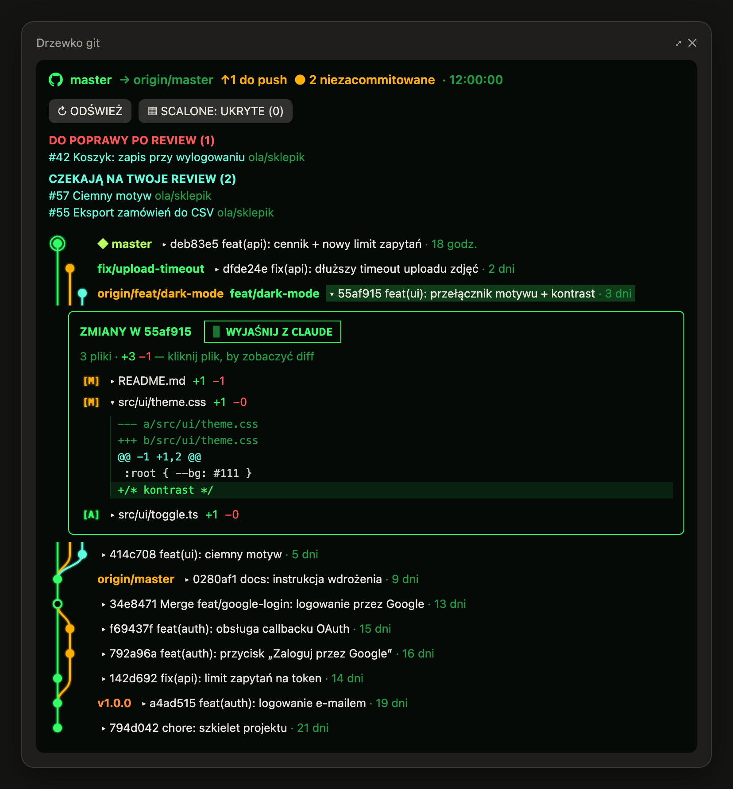
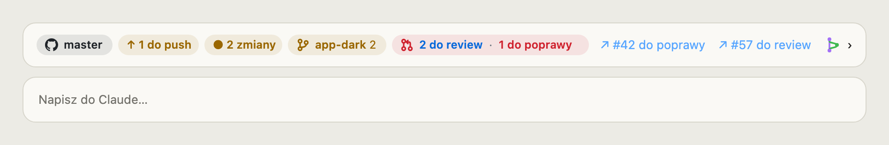

# git-tree — a git tree for Claude Code

A [Claude Code](https://claude.com/claude-code) mod that shows your git repository right in the
interface: a commit graph in a pane beside the conversation and a status band above the prompt.

<p align="center">
  
</p>

<p align="center">
  <picture>
    <source media="(prefers-color-scheme: dark)" srcset="docs/pasek-ciemny.png">
    
  </picture>
</p>

<sub>Screenshots from a demo repository. The mod's interface is in Polish.</sub>

## What it does

**Band above the prompt**
- the branch with the GitHub mark — green when it is in sync with its remote
- `↑ N do push` / `↓ N do pobrania` — commits to push and to pull (a quiet, read-only `git fetch` every 5 minutes)
- `● N zmian` — uncommitted files in the current directory
- the repo's other worktrees that hold uncommitted changes
- pull requests: how many wait for your review and how many came back with changes requested,
  with links to the newest of each
- **🤝 Handoff** — shown when Matt Pocock's `handoff` skill is installed: one click runs it so the
  next session can pick the work up. It shows ✓ afterwards and won't repeat until you say something new
- **📂 Załaduj handoff** (“load handoff”) — in a new session, when an earlier session left a handoff
  document about this repo (a `*handoff*.md` under a week old in the temp directory), it takes the
  Handoff button's place; one click asks Claude to read it and continue
- a tree glyph and `›` that open the pane

**The “Drzewko git” pane** (opens by itself, or with `/git-tree`)
- a graph of the last 50 commits, with branch and merge lines
- click a commit to unfold its changed files with GitHub-style status dots
  (amber **M** modified, green **A** added, red **D** deleted, blue **R** renamed) and `+/−` line counts;
  click a file to see its diff
- **✨ Wyjaśnij z Claude** (“explain with Claude”) drafts a question about
  the commit into the prompt box: what it changes, why, and whether anything in it looks risky —
  just press Enter; nothing is sent for you
- bot branches (dependabot, renovate) are always hidden; branches already merged
  (squash merges included) hide with one button, 🧹
- lists of PRs to review and to fix, as links
- inside a worktree: a button that closes the worktree and moves its changes into the main
  checkout as staged changes (no commit, no push); it refuses when the worktree is locked

In the desktop app the graph, the band and the status dots are drawn as SVG; in the terminal,
as text.

## Install

In a Claude Code session in a terminal:

```
/plugin install git-tree --marketplace bpor92/claude-git-tree
```

Confirm adding the marketplace (`y`) and pick the user scope so the mod works in every project.
Installed from a terminal, it also loads in local sessions of the desktop app.

### Requirements

- `git`
- [`gh`](https://cli.github.com/) signed in to GitHub (`gh auth login`) — only for the PR counts and
  lists; without it everything else works and the PR segment stays hidden

## What it runs

Only local `git` commands (reading state; it writes only when you press the close-worktree button),
`git fetch --quiet --no-tags` every 5 minutes, and read-only `gh search prs` / `gh api user` queries.
To offer a handoff it lists `$TMPDIR` and `/tmp` and reads the newest `*handoff*.md` files there,
only to check they mention this repo. Nothing is ever pushed.

## Development

```
claude plugin validate .
claude plugin test .
```

Code: `hooks/register.tsx` (hooks, pane, band), `hooks/graph.ts` (graph layout and lanes),
`hooks/band.ts` (the band as SVG, icons, status dots), `hooks/commit.ts` (a commit's files and diff),
`hooks/merged.ts` (merged-branch detection), `hooks/worktree.ts`, `hooks/prs.ts`,
`hooks/handoff.ts` (finding an earlier session's handoff document).

## License

[MIT](LICENSE)
